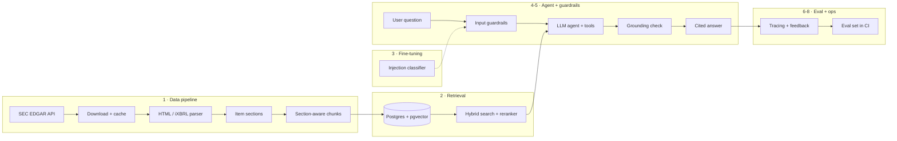

# LedgerLens

**An end-to-end AI analyst for SEC filings: data pipeline, RAG, fine-tuning, guardrails, evaluation, deployment and monitoring.**

Ask questions like *"How did Apple's R&D spend change from FY2023 to FY2025, and what supply-chain risks did they flag?"* and get answers grounded in the actual 10-K, with citations, a refusal when the filings don't support an answer, and a measured accuracy score behind every release.

> 🚧 Under active development. Phase 1 (data pipeline) is complete; see the [roadmap](#roadmap).

## Architecture



## Roadmap

| Phase | What | Status |
|---|---|---|
| 1 | **Data pipeline**: EDGAR download, iXBRL/HTML parsing, Item section splitting, table-preserving chunking | ✅ Done |
| 2 | **Retrieval**: Postgres + pgvector, hybrid BM25 + vector search, reranking, per-user access tiers | ⏳ Next |
| 3 | **Fine-tuning**: prompt-injection classifier, experiment tracking with MLflow | Planned |
| 4 | **Agent**: LLM with tools (ratio calculator, filing lookup, year-over-year compare) | Planned |
| 5 | **Guardrails**: PII redaction, injection detection, grounding check, no personalized investment advice | Planned |
| 6 | **Evaluation**: ~150-question golden set; accuracy, faithfulness, retrieval recall, latency, cost; gated in CI | Planned |
| 7 | **Serving**: FastAPI, Docker, AWS deployment, web UI | Planned |
| 8 | **Monitoring**: tracing, cost/latency dashboards, user feedback feeding the eval set | Planned |

## Phase 1: data pipeline

```
EDGAR ──► download (cached, rate-limited) ──► html_to_text ──► split_sections ──► chunk_section ──► chunks.jsonl
```

Real filings are messy, and the parser handles the cases that break naive approaches:

- **Inline XBRL noise**: hidden `ix:header` blocks and `display:none` content are stripped.
- **Financial tables**: `$`, the number and `)` usually sit in separate cells; they are merged so rows read `Total net sales | 416,161 | 391,035 | 383,285`. Tables are kept whole as their own chunks, or split by rows with the header repeated, so a number is never separated from its column.
- **Table of contents**: every "Item" heading appears twice; the real section is chosen over the TOC entry.
- **Running page headers**: filers such as Microsoft repeat "PART II / Item 7" on every page; consecutive repeats are merged so sections stay whole.
- **Frequent filers**: banks file so often that older 10-Ks fall out of EDGAR's "recent" index; the client follows the paginated history.
- **10-Q support**: items are keyed by part (`I-1`, `II-1A`) because 10-Q item numbers repeat across parts.

Each chunk carries the metadata needed for filtering and citations: ticker, form, fiscal year, filing date, accession number, Item and section title, table flag, and source URL.

**Sample run (8 filings, AAPL, MSFT, NVDA, JPM × 2 years):** 4,577 chunks, 1,573 of them tables, ~224 tokens on average.

### Known limitations

- Large banks (e.g. JPM) put MD&A and financial statements in an attached annual report, so that content currently lands under *Item 15 – Exhibits*. Mapping it back to the right Items is on the list for phase 2.
- Token counts are approximate (≈4 characters per token); exact tokenization arrives with embeddings in phase 2.

## Quick start

```bash
python3 -m venv .venv && source .venv/bin/activate
pip install -e ".[dev]"
cp .env.example .env          # set SEC_USER_AGENT to your name + email (SEC requirement)
ledgerlens-ingest --tickers AAPL MSFT NVDA --forms 10-K --limit 2
pytest
```

Output goes to `data/processed/chunks.jsonl`; raw filings are cached in `data/raw/`.

## Project layout

```
src/ledgerlens/
  config.py            settings from environment / .env
  ingest/
    edgar.py           EDGAR client: ticker → CIK, filing index, cached downloads
    parse.py           HTML/iXBRL → clean text → Item sections
    chunk.py           section-aware, table-preserving chunking
    cli.py             ledgerlens-ingest command
tests/                 parser and chunker tests on synthetic filings
```

## License

MIT
