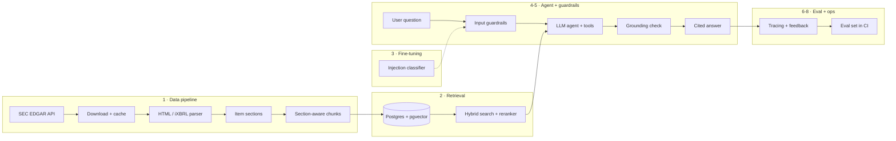

# LedgerLens

**An end-to-end AI analyst for SEC filings: data pipeline, RAG, fine-tuning, guardrails, evaluation, deployment and monitoring.**

Ask questions like *"How did Apple's R&D spend change from FY2023 to FY2025, and what supply-chain risks did they flag?"* and get answers grounded in the actual 10-K, with citations, a refusal when the filings don't support an answer, and a measured accuracy score behind every release.

> 🚧 Under active development. Phases 1 (data pipeline) and 2 (retrieval) are complete; see the [roadmap](#roadmap).

## Architecture



## Roadmap

| Phase | What | Status |
|---|---|---|
| 1 | **Data pipeline**: EDGAR download, iXBRL/HTML parsing, Item section splitting, table-preserving chunking | ✅ Done |
| 2 | **Retrieval**: Postgres + pgvector, hybrid keyword + vector search, RRF fusion, cross-encoder reranking, metadata filters | ✅ Done |
| 3 | **Fine-tuning**: prompt-injection classifier, experiment tracking with MLflow | ⏳ Next |
| 4 | **Agent**: LLM with tools (ratio calculator, filing lookup, year-over-year compare) | Planned |
| 5 | **Guardrails**: PII redaction, injection detection, grounding check, per-user access tiers, no personalized investment advice | Planned |
| 6 | **Evaluation**: ~150-question golden set; accuracy, faithfulness, retrieval recall, latency, cost; gated in CI | Planned |
| 7 | **Serving**: FastAPI, Docker, AWS deployment, web UI | Planned |
| 8 | **Monitoring**: tracing, cost/latency dashboards, user feedback feeding the eval set | Planned |

## Phase 1: data pipeline

```
EDGAR ──► download (cached, rate-limited) ──► html_to_text ──► split_sections ──► chunk_section ──► chunks.jsonl
```

Real filings are messy, and the parser handles the cases that break naive approaches:

- **Inline XBRL noise**: hidden `ix:header` blocks and `display:none` content are stripped.
- **Financial tables**: `$`, the number and `)` usually sit in separate cells; they are merged so rows read `Total net sales | 416,161 | 391,035 | 383,285`. Tables are kept whole as their own chunks, or split by rows with the header repeated, so a number is never separated from its column.
- **Table of contents**: every "Item" heading appears twice; the real section is chosen over the TOC entry.
- **Running page headers**: filers such as Microsoft repeat "PART II / Item 7" on every page; consecutive repeats are merged so sections stay whole.
- **Frequent filers**: banks file so often that older 10-Ks fall out of EDGAR's "recent" index; the client follows the paginated history.
- **10-Q support**: items are keyed by part (`I-1`, `II-1A`) because 10-Q item numbers repeat across parts.

Each chunk carries the metadata needed for filtering and citations: ticker, form, fiscal year, filing date, accession number, Item and section title, table flag, and source URL.

**Sample run (8 filings, AAPL, MSFT, NVDA, JPM × 2 years):** 4,577 chunks, 1,573 of them tables, ~224 tokens on average.

### Known limitations

- Some filers put financial statements outside Item 8: JPM in an attached annual report, NVDA at the end of the filing. That content is labeled *Item 15 – Exhibits*; search still finds it, but section filters must include `15`.
- Token counts are approximate (≈4 characters per token).

## Phase 2: retrieval

```
question ──► keyword search (Postgres full-text) ──┐
         └─► vector search (pgvector, bge-small) ──┴─► RRF fusion ──► cross-encoder rerank ──► top k + citations
```

- **One table, two indexes.** Each chunk row holds its metadata, a 384-dim embedding (HNSW index) and a generated `tsvector` (GIN index), so both retrievers share the same filters: company, fiscal year, section, form.
- **Contextual embeddings.** The embedded text is prefixed with company, form, year and section, so "Net sales increased 6%" from Apple FY2025 MD&A is distinguishable from the same sentence in another filing.
- **Reciprocal Rank Fusion** merges the keyword and vector rankings (score = Σ 1/(60 + rank)) without calibrating their incompatible scores.
- **Cross-encoder reranking** (MiniLM-L-6) reads each question–chunk pair together and picks the final top k.
- **Incremental indexing.** A content hash (text + model name) per chunk means re-runs embed only new or changed chunks and delete stale ones; switching embedding models re-embeds everything automatically.
- **Local and free.** Both models run on CPU via ONNX (fastembed); no API keys.

### Results

17 labeled questions across the 4 companies, no filters, measured on an Intel i7 laptop CPU ([`evals/retrieval_smoke.jsonl`](evals/retrieval_smoke.jsonl)):

| Mode | Hit@1 | Hit@5 | MRR@5 | Median latency |
|---|---|---|---|---|
| Keyword only | 29% | 59% | 0.38 | 36 ms |
| Vector only | 88% | 100% | 0.92 | 35 ms |
| Hybrid (RRF) | 71% | 100% | 0.81 | 67 ms |
| **Hybrid + rerank** | **100%** | **100%** | **1.00** | 1.2 s |

Findings:
- Plain hybrid fusion *lowered* top-1 accuracy versus vector-only: noisy keyword hits pushed good vector hits down. Reranking fixes the ordering.
- Reranker tuning: MiniLM-L-12 with a 30-candidate pool took 4.9 s; MiniLM-L-6 with 15 candidates scored the same at 1.2 s (4× faster).
- Indexing 4,577 chunks took 17.5 min on CPU (~4 chunks/s); a GPU or an embedding API is the path for a much larger corpus.

This is a small smoke test with lenient relevance labels (right company + section + key term). Answer-level evaluation on ~150 questions comes in phase 6.

## Quick start

```bash
python3 -m venv .venv && source .venv/bin/activate
pip install -e ".[dev]"
cp .env.example .env          # set SEC_USER_AGENT to your name + email (SEC requirement)
ledgerlens-ingest --tickers AAPL MSFT NVDA --forms 10-K --limit 2
pytest

# Phase 2: search (needs Docker)
docker compose up -d          # Postgres 16 + pgvector on port 5433
ledgerlens-index              # embed chunks and load them (incremental)
ledgerlens-search "How much did Apple spend on R&D?" --ticker AAPL --year 2025
ledgerlens-eval-retrieval evals/retrieval_smoke.jsonl
```

Chunks go to `data/processed/chunks.jsonl`, raw filings are cached in `data/raw/`, and the index lives in the `pgdata` Docker volume. Add companies any time: run `ledgerlens-ingest` with new tickers, then `ledgerlens-index`.

## Project layout

```
src/ledgerlens/
  config.py            settings from environment / .env
  ingest/
    edgar.py           EDGAR client: ticker → CIK, filing index, cached downloads
    parse.py           HTML/iXBRL → clean text → Item sections
    chunk.py           section-aware, table-preserving chunking
    cli.py             ledgerlens-ingest command
  retrieval/
    db.py              Postgres schema: metadata, pgvector embedding, tsvector
    embed.py           local embedding + reranker models, contextual chunk text
    index.py           incremental indexing (ledgerlens-index)
    search.py          keyword, vector, RRF hybrid, reranked search (ledgerlens-search)
    evaluate.py        compare search modes (ledgerlens-eval-retrieval)
evals/                 labeled retrieval queries
tests/                 parser, chunker, fusion, filter and indexing tests
docker-compose.yml     Postgres 16 + pgvector
```

## License

MIT
